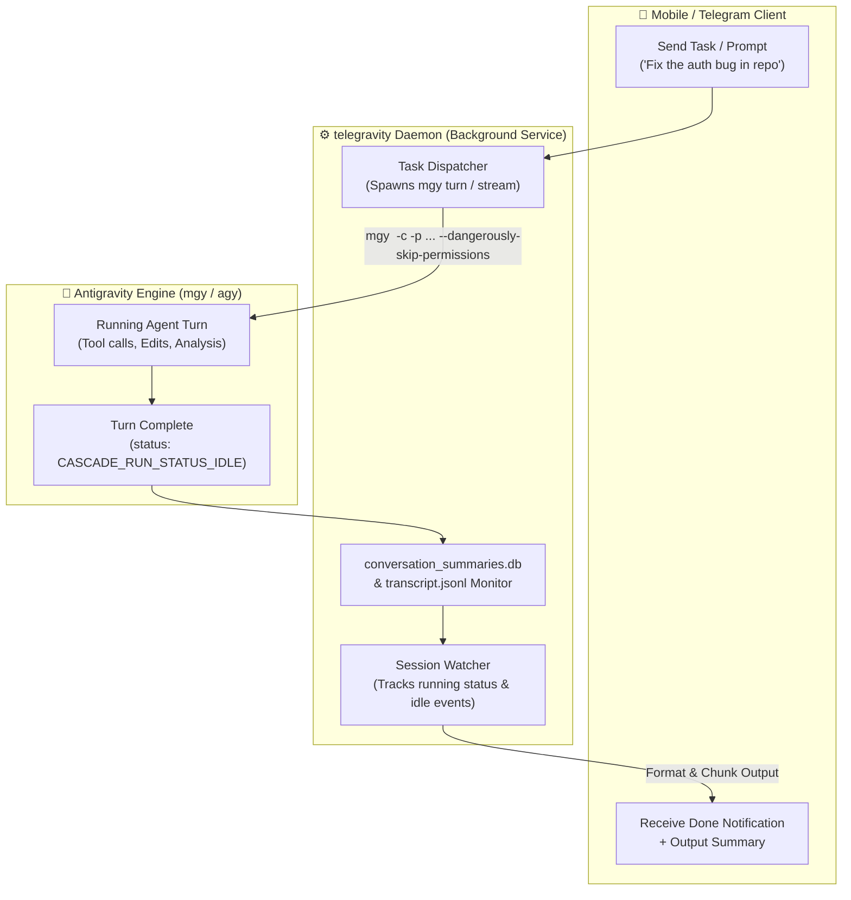

<div align="center">


# telegravity-cli

Control and interact with **Antigravity CLI (`agy`)** and **Multigravity CLI (`mgy`)** instances remotely over Telegram from any device.

</div>

---

## Overview

`telegravity-cli` is a permanent, asynchronous daemon and Telegram bot. It lets you:
1. **Dispatch coding tasks** from Telegram to your `agy` / `mgy` instances on your Raspberry Pi (or host machine).
2. **Auto-detect task completion**: As soon as the agent finishes writing code, analyzing logs, or editing files, the daemon automatically sends the formatted summary and diff to your phone.
3. **Multi-Account Profile Management (`mgy`)**: Switch between isolated accounts and profiles directly from Telegram with inline buttons (`/profiles`, `/quotas`).
4. **Passive External Session Monitoring**: Even if you start a task from your computer terminal or IDE and walk away, the daemon detects when it completes and pushes the output to Telegram.

---

## Architecture



---

## Features & Commands

| Command              | Description                                                    |
| :------------------- | :------------------------------------------------------------- |
| **Any text message** | Dispatches a task prompt to `mgy` using the active profile     |
| `/profiles`          | List all multigravity profiles and switch with tap buttons     |
| `/quotas`            | View quota usage across all profiles                           |
| `/conversations`     | View recent sessions with live status (`⚡ RUNNING` / `🟢 IDLE`) |
| `/new`               | Start a fresh session (clears conversation context)            |
| `/cancel`            | Abort/interrupt the currently running task                     |
| `/cd <path>`         | Change working directory on target host                        |
| `/pwd`               | View current working directory                                 |
| `/status`            | View host health, load, active profile, and runner state       |

---

## Quickstart & Setup

### 1. Installation

Clone repository with submodules (includes `multigravity-cli` in `vendor/`):
```bash
git clone --recurse-submodules https://github.com/wafardev/telegravity-cli.git
cd telegravity-cli

python3 -m venv .venv
source .venv/bin/activate
pip install -r requirements.txt
```

> [!NOTE]
> `multigravity-cli` (`mgy`) is bundled as a Git submodule under `vendor/multigravity-cli`.
> If running locally, `telegravity-cli` automatically detects and uses the bundled `vendor/multigravity-cli/bin/mgy`.

### 2. Configuration

Copy the example configuration:
```bash
cp .env.example .env
```

Configure your `.env`:
* `TELEGRAM_BOT_TOKEN`: Bot token from [@BotFather](https://t.me/BotFather).
* `ALLOWED_USER_IDS`: Your Telegram user ID(s) (get from [@userinfobot](https://t.me/userinfobot)).
* `RUN_MODE`: `ssh` (if running locally connecting to the Pi) or `local` (if running directly on the Pi).
* `MGY_PROFILE`: Default profile to dispatch to (e.g. `default`).
* `SSH_USER` & `SSH_HOST`: Target credentials (e.g. `pi`, `192.168.1.50` or your remote hostname).

### 3. Launching the Daemon

```bash
python bot.py
```

### 4. Running as a Permanent 24/7 Service on the Pi (Optional)

If running the daemon directly on the Raspberry Pi:
1. Copy `telegravity.service` to `/etc/systemd/system/`:
   ```bash
   sudo cp telegravity.service /etc/systemd/system/
   sudo systemctl daemon-reload
   sudo systemctl enable --now telegravity.service
   ```
2. Check logs:
   ```bash
   journalctl -u telegravity.service -f
   ```
